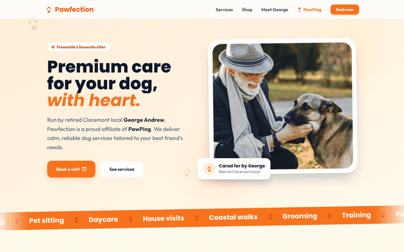
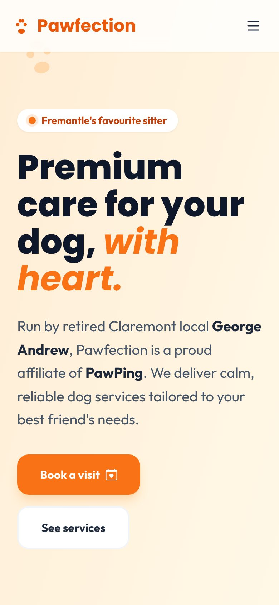

# Perth Pawfection

> Landing page for Pawfection — calm, reliable dog care in Fremantle from George Andrew, an official PawPing partner.

**Live demo:** [perth-pawfection.vercel.app](https://perth-pawfection.vercel.app)

   

## Features

- Hero with layered photo collage and a 'Premium care for your dog' headline
- Scrolling services marquee and seven service cards (pet sitting, daycare, house visits, coastal walks, grooming, training) plus a booking card
- Shop section and a 'Meet George' story with a photo collage
- Contact section with one-tap email and phone
- Links back to the partner site **[PawPing](https://perth-paw-ping.vercel.app)** in the nav, mobile menu and footer, plus the shared [brand kit](https://perth-paw-ping.vercel.app/styleguide)
- Shared motion layer (`assets/motion.css` / `motion.js`): page curtain, reveals, magnetic buttons; respects reduced motion

## Tech stack

- Plain HTML, Tailwind CSS (Play CDN) and vanilla JavaScript — nothing to build
- Bootstrap Icons and Lordicon animated icons
- WebP images with PNG fallbacks
- Hosted on Vercel (`vercel.json`: clean URLs, caching and security headers)

## Run it locally

```bash
git clone https://github.com/thedalycreative/perth-pawfection.git
cd perth-pawfection
npx serve .        # or: python3 -m http.server 8000
```

## Deployment (Vercel)

Static site — no build step, output directory is the repo root. The Vercel project **perth-pawfection** is linked to this repo and deploys `main` to production at **https://perth-pawfection.vercel.app**.

This page used to live at `/pawfection` on [perth-paw-ping](https://github.com/thedalycreative/perth-paw-ping); that path now redirects here.

## Screenshots



<p align="center">
  
  
  
</p>

_Captured from the live site (https://perth-pawfection.vercel.app). Regenerate with any headless browser; files live in `docs/screenshots/`._

---

Built by [The Daly Creative](https://www.thedalycreative.com) · Perth, WA
